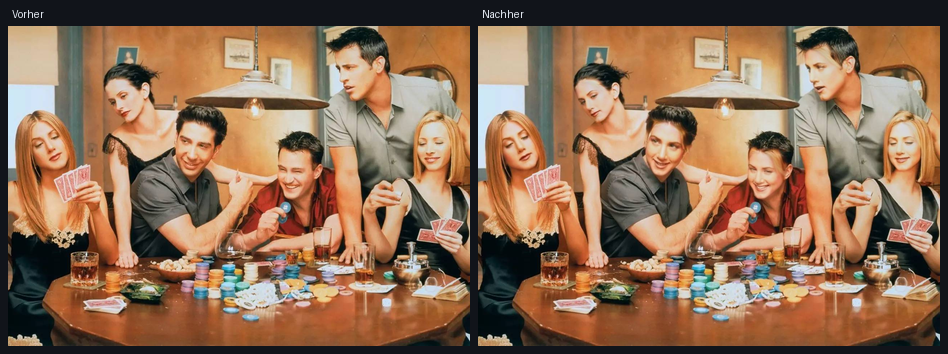

# ⚡ Oxx' FaceSwap

Lokaler Face Swap für Bilder: Ein Gesicht aus einem Spenderfoto wird auf die
Gesichter in einem Zielfoto übertragen. Alles läuft **offline auf deinem PC** –
keine Uploads, kein Cloud-Konto, kein Abo.



---

## Was es kann

- **Gesichter automatisch finden** (SCRFD-Detektor, buffalo_l) und von links nach rechts nummerieren
- **Alle Gesichter oder gezielt einzelne** im Zielbild austauschen
- **Spender-Gesicht wählen**: größtes Gesicht, eine bestimmte Nummer – oder bequem per
  **Dropdown aus dem Ordner `heads/`**
- **Bilder einfügen statt suchen**: `Strg+V` (oder Button „Einfügen“) übernimmt ein Bild
  direkt aus der Zwischenablage – für Quelle und Ziel
- **Ergebnis mit einem Klick kopieren** (📋 Button bzw. `Strg+C`), um es z. B. in
  WhatsApp, Discord oder Word mit `Strg+V` einzufügen
- **GUI mit Live-Vorschau**: Gesichtsboxen, Original/Ergebnis umschalten, Auto-Speichern
- **CLI** für Stapelverarbeitung mehrerer Bilder
- **CPU oder NVIDIA-GPU** (CUDA) – CPU reicht für ein paar Bilder locker, ~0,4–1 s pro Gesicht
- Unicode-taugliche Dateipfade (Umlaute, Leerzeichen) und EXIF-Drehung werden korrekt behandelt

---

## Installation (einmalig)

Voraussetzung: **Python 3.10 oder neuer**
([python.org](https://www.python.org/downloads/), unter Windows beim Setup
„Add python.exe to PATH“ anhaken).

### Windows

1. Im Projektordner **`install.bat`** doppelklicken (oder im Terminal
   `powershell -ExecutionPolicy Bypass -File .\install.ps1`).
2. Das Skript erstellt `.venv`, installiert die Abhängigkeiten und lädt die
   Modelle (ca. 840 MB) nach `models/`.

Mit NVIDIA-GPU zusätzlich: `powershell -ExecutionPolicy Bypass -File .\install.ps1 -Cuda`

### Linux, macOS oder Git Bash (Windows)

1. **`./install.sh`** ausführen (oder `bash install.sh`).
2. Das Skript erstellt `.venv`, installiert die Abhängigkeiten und lädt die
   Modelle (ca. 840 MB) nach `models/`.

Mit NVIDIA-GPU zusätzlich: `./install.sh --cuda`  
Modelle neu herunterladen (auch wenn schon vorhanden): `./install.sh --force`

### Manuell, ohne Skript

```bash
python3 -m venv .venv
./.venv/bin/python -m pip install -r requirements.txt
# Modelle: siehe Abschnitt "Modelle" weiter unten
```

---

## GUI starten

### Windows

**`Oxx' FaceSwap.bat`** oder **`start_gui.bat`** doppelklicken – oder:

```powershell
.\.venv\Scripts\python.exe faceswap_gui.py
```

Gibt es Probleme, zeigt der Debug-Modus die Fehlermeldung im Fenster:

```powershell
start_gui.bat debug
```

### Linux, macOS oder Git Bash (Windows)

```bash
./start_gui.sh
```

Mit Konsole (zeigt Fehlermeldungen im Terminal):

```bash
./start_gui.sh debug
```

Direkt mit Python:

```bash
./.venv/bin/python faceswap_gui.py
```

### Bedienung

1. **Spenderbild** (links) und **Zielbild** (rechts) festlegen – auf drei Wegen:
   - „Wählen…“ für einen Dateidialog,
   - **`Strg+V`** fügt ein Bild aus der Zwischenablage in das **aktive** Bild ein
     (das Panel mit dem grünen Rahmen; per Klick aktivieren),
   - beim Spender zusätzlich das **Dropdown „Aus heads/“** für vorbereitete Gesichter.
2. Warten, bis unten `Spender: x Gesicht(er) · Ziel: y Gesicht(er)` steht.
3. Optional „Spender-Gesicht“ und „Zielgesichter“ einstellen.
4. **⚡ Gesichter tauschen** – das Ergebnis wird angezeigt und automatisch in
   `output/` gespeichert.
5. Ergebnis verwenden:
   - **📋 Kopieren** (oder `Strg+C`) → direkt in WhatsApp & Co. mit `Strg+V` einfügen,
   - **Speichern unter…** (`Strg+S`) → als Datei ablegen.

Tastenkürzel: `Strg+V` einfügen · `Strg+C` Ergebnis kopieren · `Strg+O` Spender ·
`Strg+T` Ziel · `Strg+S` speichern · `F5` tauschen

### Ordner `heads/`

Alle Bilder in `heads/` (auch in Unterordnern) erscheinen im Dropdown beim
Spenderbild und lassen sich mit einem Klick als Quelle laden. Ideal für eine
Sammlung von Spender-Gesichtern. Der Ordner wird beim ersten Start automatisch
angelegt; `↻` liest ihn neu ein, wenn du Bilder hinzugefügt hast.

---

## CLI benutzen

### Windows

```powershell
# Ein Bild, alle Gesichter
.\.venv\Scripts\python.exe faceswap_cli.py --source spender.jpg --target gruppe.jpg

# Nur Gesicht 2 und 4 tauschen, Ergebnis angeben
.\.venv\Scripts\python.exe faceswap_cli.py -s spender.jpg -t gruppe.jpg --face 2,4 -o fertig.jpg

# Mehrere Zielbilder (Ausgabe ist dann ein Ordner)
.\.venv\Scripts\python.exe faceswap_cli.py -s spender.jpg -t a.jpg b.jpg c.jpg -o ergebnisse

# Nur schauen, welche Gesichter gefunden werden
.\.venv\Scripts\python.exe faceswap_cli.py --target gruppe.jpg --list
```

### Linux, macOS oder Git Bash (Windows)

```bash
# Ein Bild, alle Gesichter
./faceswap_cli.sh --source spender.jpg --target gruppe.jpg

# Nur Gesicht 2 und 4 tauschen, Ergebnis angeben
./faceswap_cli.sh -s spender.jpg -t gruppe.jpg --face 2,4 -o fertig.jpg

# Mehrere Zielbilder (Ausgabe ist dann ein Ordner)
./faceswap_cli.sh -s spender.jpg -t a.jpg b.jpg c.jpg -o ergebnisse

# Nur schauen, welche Gesichter gefunden werden
./faceswap_cli.sh --target gruppe.jpg --list
```

Oder direkt mit Python:

```bash
./.venv/bin/python faceswap_cli.py --help
```

Wichtige Optionen:

| Option | Bedeutung |
| --- | --- |
| `--source`, `-s` | Spenderbild (mit dem Gesicht) |
| `--target`, `-t` | Ein oder mehrere Zielbilder |
| `--output`, `-o` | Ausgabedatei bzw. Ausgabeordner |
| `--face`, `-f` | Zielgesichter: `all`, `1`, `1,3`, `1-3` (Standard `all`) |
| `--source-face` | Nummer des Spender-Gesichts (Standard: größtes) |
| `--device` | `auto`, `cpu` oder `cuda` |
| `--det-size` | Detektor-Auflösung, Standard 640 |
| `--quality` | JPEG-Qualität, Standard 95 |
| `--list` | Nur Gesichter auflisten |

Ohne `-o` landet das Ergebnis als `output/<name>_swapped.jpg`.

---

## Modelle

Beim Setup werden zwei Pakete nach `models/` geladen:

| Datei | Zweck | Größe |
| --- | --- | --- |
| `models/buffalo_l/` | Gesichtserkennung + Embedding (SCRFD + ArcFace) | ~275 MB |
| `models/inswapper_128.onnx` | eigentliches Swap-Modell | ~528 MB |

Beide stammen aus dem offiziellen
[InsightFace Model Zoo Release](https://github.com/deepinsight/insightface/releases/tag/model-zoo).
Fehlen sie, meldet die App das mit dem Hinweis, `install.ps1` auszuführen.

---

## Tipps für gute Ergebnisse

- Spenderbild: **frontal, scharf, gute Beleuchtung**, ein Gesicht im Bild.
- Zielgesicht möglichst ähnlich ausgerichtet (Blickrichtung, Kopfhaltung).
- Sehr kleine Gesichter (< ca. 80 px) oder starke Profilansichten werden unschärfer.
- Füllt ein Gesicht das ganze Bild (extremer Kopfausschnitt), ergänzt die App
  automatisch einen Rand – das klappt, ist aber etwas ungenauer.
- Bei niedriger Detektionsrate: `--det-size 1024` erhöhen (langsamer, genauer).
- Das Ergebnis ist ein 128×128-Swap, der maskiert eingepasst wird – bei
  Brillen, Händen vor dem Gesicht oder extremen Posen bleiben Artefakte.

---

## Rechtliches und Verantwortung

Dieses Programm ist ein Werkzeug für kreative, humorvolle und
Einverständnis-basierte Bearbeitung. Verwende es nur mit Personen, die dem
Tausch ausdrücklich zugestimmt haben, und kennzeichne bearbeitete Bilder, wenn
du sie veröffentlichst. Inhalte, die täuschen, belästigen oder schaden, sind
Missbrauch – dafür ist dieses Projekt nicht gedacht.

Die InsightFace-Modelle (`buffalo_l`, `inswapper_128`) sind laut
Projektlizenz **nur für nicht-kommerzielle Forschung** freigegeben.

---

## Projektstruktur

```
zeug/
├─ Oxx' FaceSwap.bat        # GUI starten (Doppelklick, Windows)
├─ Oxx' FaceSwap.sh         # GUI starten (Linux, macOS, Git Bash)
├─ start_gui.bat            # gleicher Starter, ausführliche Version (Windows)
├─ start_gui.sh             # gleicher Starter, ausführliche Version (Linux, macOS, Git Bash)
├─ install.bat / install.ps1# Einrichtung + Modelldownload (Windows)
├─ install.sh               # Einrichtung + Modelldownload (Linux, macOS, Git Bash)
├─ FaceSwap-CLI.bat         # CLI-Hilfe (Windows)
├─ faceswap_cli.sh          # CLI-Starter (Linux, macOS, Git Bash)
├─ faceswap_gui.py          # grafische Oberfläche (Tkinter)
├─ faceswap_cli.py          # Kommandozeile
├─ faceswap/
│  ├─ engine.py             # Detektion, Embeddings, Swap, Bild-I/O
│  ├─ clipboard.py          # Bilder kopieren/einfügen (Windows-Zwischenablage)
│  └─ __init__.py
├─ heads/                   # eigene Spenderbilder (erscheinen im Dropdown)
├─ models/                  # ONNX-Modelle (nicht im Repo)
├─ samples/                 # Beispielbilder zum Ausprobieren
├─ output/                  # automatisch gespeicherte Ergebnisse
└─ assets/                  # App-Icon & Copy-Symbol
```

---

## Fehlersuche

| Problem | Lösung |
| --- | --- |
| „Modelle fehlen“ | `install.bat` erneut ausführen, Internetverbindung prüfen |
| „Im Quellbild wurde kein Gesicht gefunden“ | anderes, frontaleres Spenderbild nehmen (ein sehr enger 112×112-Ausschnitt reicht oft nicht) |
| `Strg+V` fügt nichts ein | Bild vorher kopieren (Screenshot, „Bild kopieren“ im Explorer/Browser); Text ohne Bild wird abgelehnt |
| Kopieren in WhatsApp scheitert | Button „📋 Kopieren“ nutzen – manche Programme wollen PNG, dann erst „Speichern unter…“ als PNG |
| `CUDA angefordert, aber nicht verfügbar` | `install.ps1 -Cuda` bzw. `pip install onnxruntime-gpu` |
| Alles läuft sehr langsam | CPU-Modus nutzt alle Kerne, ist aber pro Gesicht ~0,4–1 s; für Videos wäre eine GPU sinnvoll |
| Fenster öffnet sich nicht bei `Oxx' FaceSwap.bat` | `start_gui.bat debug` ausführen – dort steht die Fehlermeldung im Fenster |
| Dropdown „Aus heads/“ bleibt leer | Bilder in den Ordner `heads/` legen und `↻` klicken |
